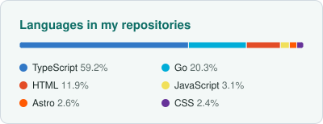

<!-- Generated daily by .github/workflows/update-cards.yml -->

  
<samp>Brewing...</samp>

  <picture>
    <source media="(prefers-color-scheme: dark)" srcset="./images/languages-dark.svg" />
    <source media="(prefers-color-scheme: light), (prefers-color-scheme: no-preference)" srcset="./images/languages-light.svg" />
    
  </picture>

